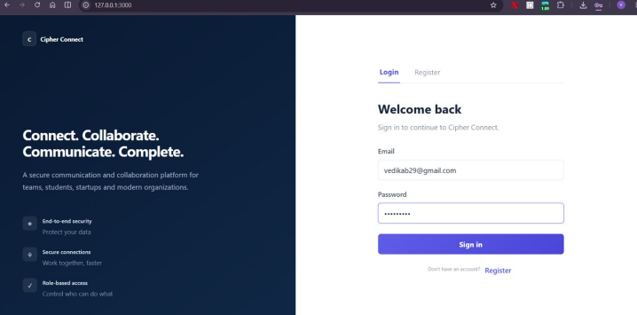
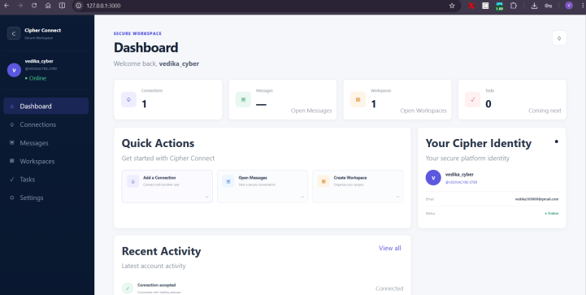
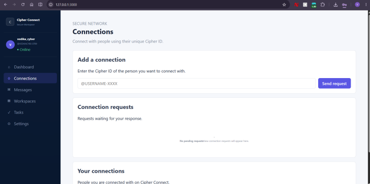

<div align="center">

# 🔐 Cipher Connect

**Secure Workspace — Connect • Collaborate • Communicate • Complete**


</div>

Cipher Connect is a cybersecurity-focused communication and collaboration platform. It provides a structured environment for secure user connections, messaging, and team collaboration, with an emphasis on authentication, controlled access, and secure application design.

---

## 📑 Table of Contents

- [Key Features](#-key-features)
- [Technology Stack](#️-technology-stack)
- [System Architecture](#️-system-architecture)
- [Project Structure](#-project-structure)
- [Screenshots](#-screenshots)
- [Installation and Setup](#️-installation-and-setup)
- [User Guide](#-user-guide)
- [Security Considerations](#-security-considerations)
- [Future Enhancements](#-future-enhancements)
- [Project Information](#-project-information)

---

## ✨ Key Features

### 1. User Authentication
- User registration and login
- JWT-based authentication
- Unique Cipher ID for user identification
- Protected application endpoints

### 2. Connections Management
- Connect with other users using their Cipher ID or email
- Send and manage connection requests
- Accept or reject incoming requests
- View connection status

### 3. Direct Messaging
- Direct conversations between connected users
- Message management through REST APIs
- WebSocket/STOMP-based real-time communication

### 4. Collaboration Workspace
- Workspace-oriented collaboration structure
- Channels for organizing discussions
- Task management and file-sharing capabilities

> [!NOTE]
> Availability of individual features depends on what is implemented in the current version of the application.

---

## 🛠️ Technology Stack

| Layer | Technologies |
|---|---|
| **Frontend** | React.js, JavaScript, HTML5, CSS3 |
| **Backend** | Java 21, Spring Boot |
| **Database** | PostgreSQL |
| **Authentication** | Spring Security, JWT |
| **Communication** | REST APIs, WebSocket, STOMP |
| **Build Tool** | Maven |
| **Development Tools** | VS Code, Git, GitHub |

---

## 🏗️ System Architecture

Cipher Connect follows a frontend–backend architecture:

| Component | Responsibility |
|---|---|
| **Frontend** | React provides the user interface and handles user interactions. |
| **Backend** | Spring Boot manages application logic, authentication, and API requests. |
| **Database** | PostgreSQL stores user accounts, connections, conversations, and messages. |
| **Security** | Spring Security and JWT provide authentication and protected API access. |

---

## 📁 Project Structure

The project is split into separate frontend and backend components to keep it modular and easy to maintain.

```text
Cipher-Connect/
├── backend/
│   └── cipher-connect-backend/
│       ├── src/main/
│       │   ├── java/com/cipherconnect/backend/
│       │   │   ├── config/
│       │   │   ├── controller/
│       │   │   ├── model/
│       │   │   ├── repository/
│       │   │   ├── security/
│       │   │   └── service/
│       │   └── resources/
│       │       └── application.properties
│       └── pom.xml
├── frontend/
│   ├── src/
│   ├── public/
│   └── package.json
├── docs/
│   └── screenshots/
│       ├── login.png
│       ├── dashboard.png
│       ├── connections.png
│       └── messaging.png
├── README.md
└── .gitignore
```

| Path | Description |
|---|---|
| `backend/` | Java Spring Boot backend |
| `frontend/` | React frontend and user interface |
| `src/main/java/` | Backend application source code |
| `config/` | Application and security configuration |
| `controller/` | Handles incoming API requests |
| `model/` | Application data models |
| `repository/` | Database operations |
| `security/` | JWT and authentication components |
| `service/` | Business logic |
| `resources/` | Backend configuration and resources |
| `docs/screenshots/` | Application screenshots |
| `pom.xml` | Maven project configuration |
| `package.json` | Frontend dependencies and scripts |

---

## 📸 Screenshots

| Login Page | Dashboard |
|:---:|:---:|
|  |  |

| Connections | Messaging |
|:---:|:---:|
|  |  |

---

## ⚙️ Installation and Setup

### Prerequisites

- Java JDK 21
- Node.js and npm
- PostgreSQL
- Apache Maven
- Git

### 1. Clone the Repository

```bash
git clone https://github.com/vedikab29-byte/Cipher-Connect.git
cd Cipher-Connect
```

### 2. Configure the Database

Create the database in PostgreSQL:

```sql
CREATE DATABASE cipher_connect;
```

Then set your connection details in the backend's `application.properties` file.

> [!WARNING]
> Use your own local database credentials. Never upload passwords or private keys to GitHub.

### 3. Run the Backend

```bash
cd backend/cipher-connect-backend
mvn clean install
mvn spring-boot:run
```

The backend runs at `http://localhost:8080`.
Health check: `http://localhost:8080/api/health`

### 4. Run the Frontend

In a second terminal, go to the directory containing the frontend's `package.json`:

```bash
cd frontend
npm install
npm run dev
```

> [!TIP]
> If your project uses a different start script, use the corresponding command from `package.json`.

### 5. Open the Application

Open the local frontend URL shown in your terminal. Make sure PostgreSQL and the Spring Boot backend are running first.

---

## 📖 User Guide

1. **Get started** — Launch the frontend and backend, open Cipher Connect in your browser, then register or log in.
2. **Find your Cipher ID** — Locate your unique Cipher ID in your account and share it (not your password) with people you want to connect with.
3. **Manage connections** — Open the Connections section, search by Cipher ID or email, send requests, and accept or manage incoming ones.
4. **Message directly** — Open the messaging section, select a connection, and start a conversation.
5. **Collaborate** — Explore workspaces and channels, plus the available task management and file-sharing features.
6. **Log out** — Use the logout option to securely end your session.

### 💡 Usage Tips

- Keep your login credentials private.
- Share your Cipher ID, never your account password.
- Communicate only with authorized connections.
- Log out when using a shared computer.
- Never share sensitive information through an unverified account.

---

## 🔒 Security Considerations

- JWT-based authentication
- Protected backend endpoints
- Password hashing
- Role-based access control (where implemented)
- Secure handling of user credentials
- Database-backed application data

> [!IMPORTANT]
> Cipher Connect is designed with secure communication principles in mind. It should not be described as end-to-end encrypted unless true end-to-end message encryption has been implemented and verified.

---

## 🚀 Future Enhancements

- [ ] Enhanced role-based access control
- [ ] Improved workspace and channel management
- [ ] Secure file-sharing enhancements
- [ ] Comprehensive audit logging
- [ ] Additional security testing
- [ ] Production deployment and monitoring

---

## 👩‍💻 Project Information

| | |
|---|---|
| **Project Name** | Cipher Connect |
| **Category** | Cybersecurity / Secure Collaboration |
| **Architecture** | React frontend + Spring Boot backend |
| **Database** | PostgreSQL |
| **Repository** | [github.com/vedikab29-byte/Cipher-Connect](https://github.com/vedikab29-byte/Cipher-Connect) |

---

<div align="center">

*Cipher Connect — A structured space for secure connections and collaboration.*

</div>
