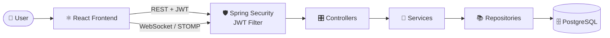
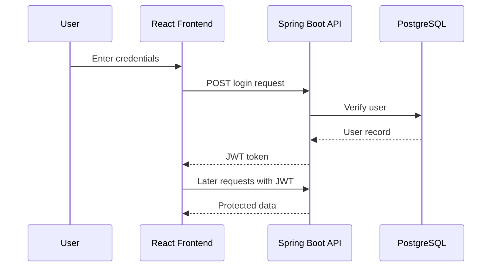
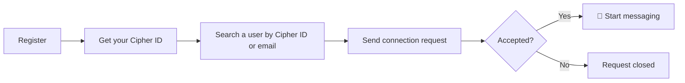
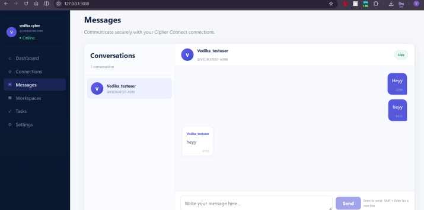

<div align="center">

# 🔐 Cipher Connect

### Secure Workspace — Connect • Collaborate • Communicate • Complete

*A cybersecurity-focused platform where authenticated users connect, chat, and collaborate in one protected space.*


**Built by [Vedika Bhatnagar](https://github.com/vedikab29-byte)**

[Features](#-key-features) • [Architecture](#️-system-architecture) • [Screenshots](#-screenshots) • [Setup](#️-installation-and-setup) • [Security](#-security-considerations) • [Author](#-about-the-author)

</div>

---

## 📑 Table of Contents

- [About the Project](#-about-the-project)
- [Why Cipher Connect?](#-why-cipher-connect)
- [Key Features](#-key-features)
- [Technology Stack](#️-technology-stack)
- [System Architecture](#️-system-architecture)
- [How It Works](#-how-it-works)
- [Screenshots](#-screenshots)
- [Project Structure](#-project-structure)
- [Installation and Setup](#️-installation-and-setup)
- [User Guide](#-user-guide)
- [Security Considerations](#-security-considerations)
- [Future Enhancements](#-future-enhancements)
- [What I Learned](#-what-i-learned)
- [About the Author](#-about-the-author)

---

## 🌟 About the Project

Most communication tools treat security as an afterthought. **Cipher Connect** puts it first. It brings together user connections, direct messaging, and workspace collaboration inside a single platform, where every request passes through authentication and access control.

The project combines a **React** frontend with a **Java Spring Boot** backend and a **PostgreSQL** database. Security is handled by **Spring Security** and **JWT**, and real-time messaging is built on **WebSocket/STOMP**.

## 💡 Why Cipher Connect?

| 🎯 Goal | 🔎 How Cipher Connect approaches it |
|---|---|
| **Know who you're talking to** | Every user gets a unique **Cipher ID** and must authenticate before accessing the platform. |
| **Control who can reach you** | Users can only message people they have an accepted connection with. |
| **Protect the API** | Backend endpoints are guarded by JWT-based authentication. |
| **Keep work in one place** | Messaging, channels, tasks, and file sharing live in one workspace. |
| **Stay maintainable** | A clean layered backend (controller → service → repository) and a separate frontend. |

---

## ✨ Key Features

### 🔑 1. User Authentication
- User registration and login
- JWT-based, stateless authentication
- Unique **Cipher ID** for every user
- Protected application endpoints

### 🤝 2. Connections Management
- Find people by **Cipher ID** or **email**
- Send, accept, or reject connection requests
- Track connection status at a glance

### 💬 3. Direct Messaging
- One-to-one conversations between connected users
- Message management through REST APIs
- Real-time communication using WebSocket/STOMP

### 🗂️ 4. Collaboration Workspace
- Workspace-oriented structure
- Channels for organizing discussions
- Task management and file-sharing capabilities

> [!NOTE]
> Availability of individual features depends on what is implemented in the current version of the application.

---

## 🛠️ Technology Stack

| Layer | Technologies |
|---|---|
| 🎨 **Frontend** | React.js, JavaScript, HTML5, CSS3 |
| ⚙️ **Backend** | Java 21, Spring Boot |
| 🗄️ **Database** | PostgreSQL |
| 🛡️ **Authentication** | Spring Security, JWT |
| 📡 **Communication** | REST APIs, WebSocket, STOMP |
| 📦 **Build Tool** | Maven |
| 🧰 **Development Tools** | VS Code, Git, GitHub |

---

## 🏗️ System Architecture

Cipher Connect follows a frontend–backend architecture with a dedicated security layer.



| Component | Responsibility |
|---|---|
| **Frontend** | React provides the user interface and handles user interactions. |
| **Backend** | Spring Boot manages application logic, authentication, and API requests. |
| **Database** | PostgreSQL stores user accounts, connections, conversations, and messages. |
| **Security** | Spring Security and JWT provide authentication and protected API access. |

---

## 🔄 How It Works

### Authentication flow



### Connecting and messaging



---

## 📸 Screenshots

### 🔐 Login Page
<p align="center">
  
</p>

### 📊 Dashboard
<p align="center">
  
</p>

### 🤝 Connections
<p align="center">
  
</p>

### 💬 Messaging
<p align="center">
  
</p>

> [!TIP]
> Add more real screenshots to `docs/screenshots/` (for example `register.png`, `workspace.png`, `channels.png`, `tasks.png`) and reference them the same way. Real captures of your running app will make this README far more convincing than any mock-up.

---

## 📁 Project Structure

```text
Cipher-Connect/
├── backend/
│   └── cipher-connect-backend/
│       ├── src/main/
│       │   ├── java/com/cipherconnect/backend/
│       │   │   ├── config/
│       │   │   ├── controller/
│       │   │   ├── model/
│       │   │   ├── repository/
│       │   │   ├── security/
│       │   │   └── service/
│       │   └── resources/
│       │       └── application.properties
│       └── pom.xml
├── frontend/
│   ├── src/
│   ├── public/
│   └── package.json
├── docs/
│   └── screenshots/
│       ├── login.png
│       ├── dashboard.png
│       ├── connections.png
│       └── messaging.png
├── README.md
└── .gitignore
```

<details>
<summary><b>📂 Directory overview (click to expand)</b></summary>

| Path | Description |
|---|---|
| `backend/` | Java Spring Boot backend |
| `frontend/` | React frontend and user interface |
| `src/main/java/` | Backend application source code |
| `config/` | Application and security configuration |
| `controller/` | Handles incoming API requests |
| `model/` | Application data models |
| `repository/` | Database operations |
| `security/` | JWT and authentication components |
| `service/` | Business logic |
| `resources/` | Backend configuration and resources |
| `docs/screenshots/` | Application screenshots |
| `pom.xml` | Maven project configuration |
| `package.json` | Frontend dependencies and scripts |

</details>

---

## ⚙️ Installation and Setup

### Prerequisites

- ☕ Java JDK 21
- 🟢 Node.js and npm
- 🐘 PostgreSQL
- 📦 Apache Maven
- 🌿 Git

### 1️⃣ Clone the Repository

```bash
git clone https://github.com/vedikab29-byte/Cipher-Connect.git
cd Cipher-Connect
```

### 2️⃣ Configure the Database

```sql
CREATE DATABASE cipher_connect;
```

Then set your connection details in the backend's `application.properties` file.

> [!WARNING]
> Use your own local database credentials. Never upload passwords or private keys to GitHub.

### 3️⃣ Run the Backend

```bash
cd backend/cipher-connect-backend
mvn clean install
mvn spring-boot:run
```

- Backend URL: `http://localhost:8080`
- Health check: `http://localhost:8080/api/health`

### 4️⃣ Run the Frontend

In a second terminal:

```bash
cd frontend
npm install
npm run dev
```

> [!TIP]
> If your project uses a different start script, use the corresponding command from `package.json`.

### 5️⃣ Open the Application

Open the local frontend URL shown in your terminal. Make sure PostgreSQL and the Spring Boot backend are running first.

---

## 📖 User Guide

| Step | What to do |
|---|---|
| **1. Get started** | Launch the frontend and backend, open Cipher Connect in your browser, then register or log in. |
| **2. Find your Cipher ID** | Locate your unique Cipher ID in your account and share it (never your password) with people you want to connect with. |
| **3. Manage connections** | Open the Connections section, search by Cipher ID or email, send requests, and accept or manage incoming ones. |
| **4. Message directly** | Open messaging, select a connection, and start a conversation. |
| **5. Collaborate** | Explore workspaces and channels, plus the available task management and file-sharing features. |
| **6. Log out** | Use the logout option to securely end your session. |

### 💡 Usage Tips

- 🔒 Keep your login credentials private.
- 🆔 Share your Cipher ID, never your account password.
- ✅ Communicate only with authorized connections.
- 💻 Log out when using a shared computer.
- ⚠️ Never share sensitive information through an unverified account.

---

## 🔒 Security Considerations

| Area | Approach |
|---|---|
| **Authentication** | JWT-based authentication |
| **API protection** | Protected backend endpoints |
| **Credentials** | Password hashing and secure handling of user credentials |
| **Authorization** | Role-based access control where implemented |
| **Data** | Database-backed application data |

> [!IMPORTANT]
> Cipher Connect is designed with secure communication principles in mind. It should not be described as end-to-end encrypted unless true end-to-end message encryption has been implemented and verified.

---

## 🚀 Future Enhancements

- [ ] Enhanced role-based access control
- [ ] Improved workspace and channel management
- [ ] Secure file-sharing enhancements
- [ ] Comprehensive audit logging
- [ ] Additional security testing
- [ ] Production deployment and monitoring

---

## 🎓 What I Learned

- Designing a layered **Spring Boot** application with clear separation of concerns
- Implementing **JWT authentication** with Spring Security
- Building real-time features with **WebSocket/STOMP**
- Modelling relational data (users, connections, conversations, messages) in **PostgreSQL**
- Connecting a **React** frontend to a secured REST API
- Thinking about security as a design requirement, not an add-on

---

## 👩‍💻 About the Author

<table>
  <tr>
    <td>
      <b>Vedika Bhatnagar</b><br/>
      B.E. Computer Science &amp; Engineering student, Chandigarh University<br/>
      Full Stack Developer (Java Full Stack internship experience)<br/><br/>
      🔗 <a href="https://github.com/vedikab29-byte">GitHub: vedikab29-byte</a>
    </td>
  </tr>
</table>

| | |
|---|---|
| **Project Name** | Cipher Connect |
| **Category** | Cybersecurity / Secure Collaboration |
| **Architecture** | React frontend + Spring Boot backend |
| **Database** | PostgreSQL |
| **Repository** | [github.com/vedikab29-byte/Cipher-Connect](https://github.com/vedikab29-byte/Cipher-Connect) |

---

<div align="center">

⭐ *If you found this project interesting, consider giving it a star!* ⭐

**Cipher Connect — A structured space for secure connections and collaboration.**

</div>
